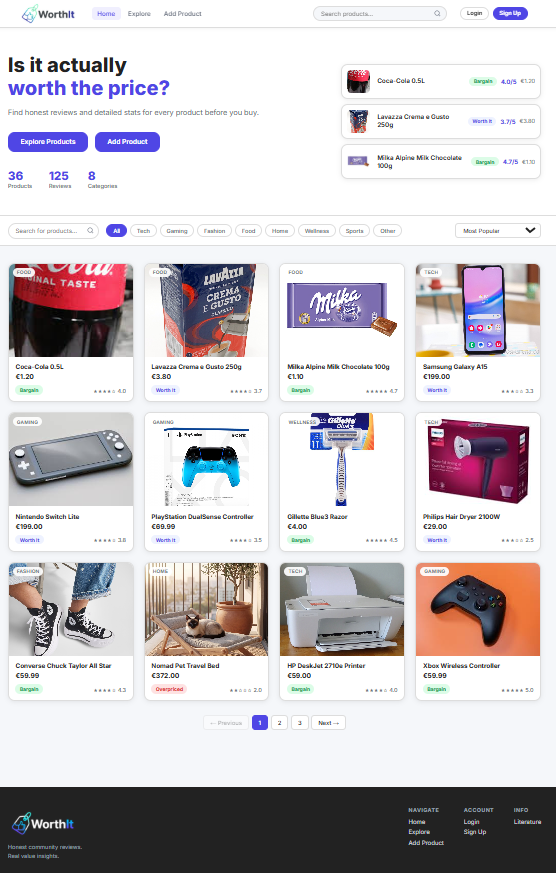
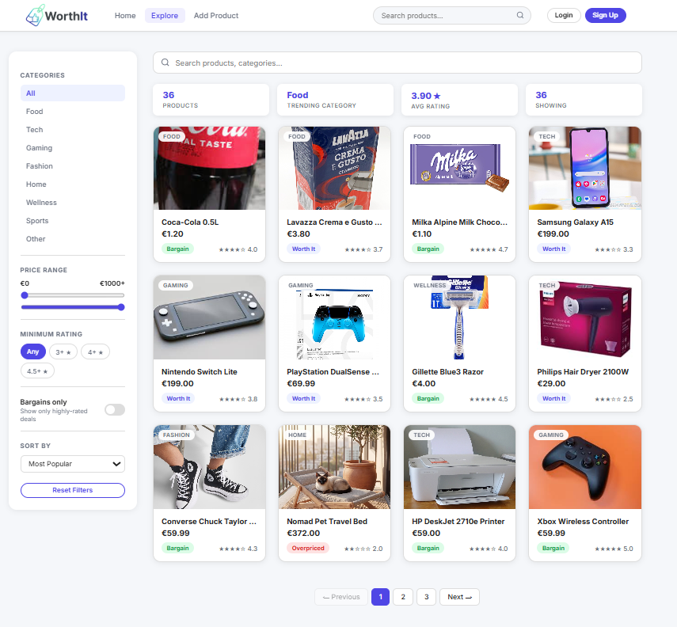
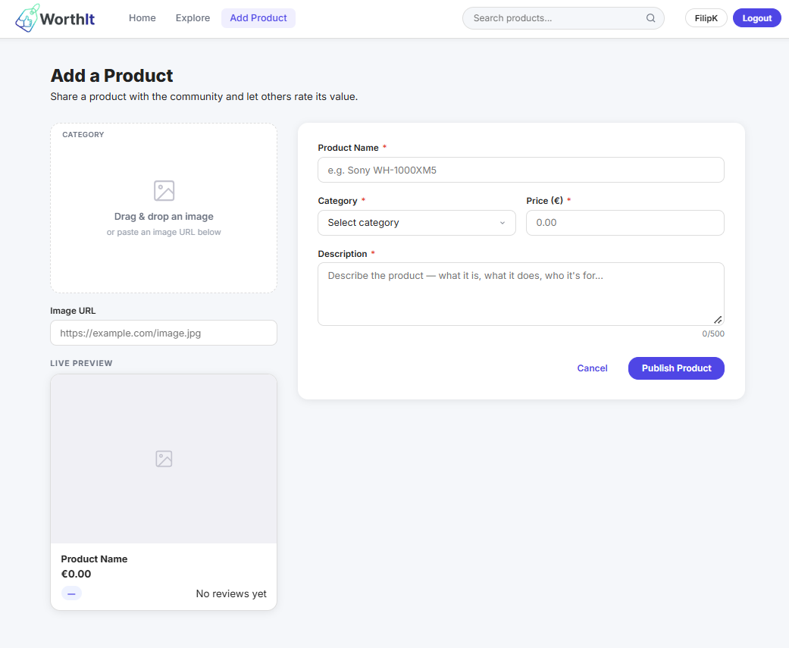
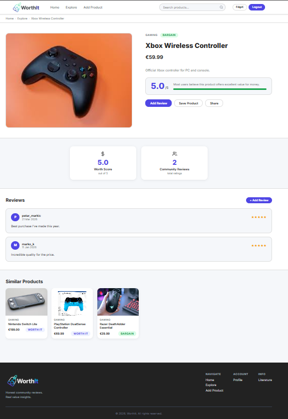

# WorthIt

WorthIt is a web application where users rate and review products to help others decide if they're worth the price. Users can browse products, leave reviews, and see whether something is a **Bargain**, **Worth It**, or **Overpriced** based on community ratings.

## Live

https://worthit-fk.netlify.app

## Tech Stack

**Frontend:** HTML, CSS, JavaScript  
**Backend:** Node.js, Express.js  
**Database:** Firebase Firestore

## Features

- Browse and search products by category, price, and rating
- Add products with image, description, and category
- Leave reviews with a 1–5 value rating
- Automatic status calculation (Bargain / Worth It / Overpriced)
- User profile with reviews, added products, and saved products
- Save products for later
- Responsive design

## Screenshots

| Home | 
| :---: | 
|  |

| Explore |
| :---: |
|  | 

| Add Product | 
| :---: |
|  | 

| Product Info |
| :---: | 
|  |

## Author

Filip Kampić  
Faculty of Electrical Engineering, Computer Science and Information Technology Osijek (FERIT)  
Web Programming — 2026
